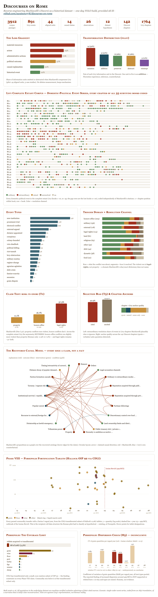
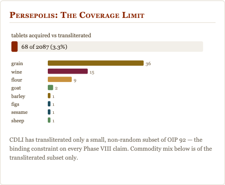
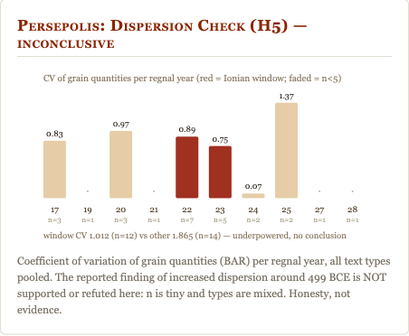

# Discourses on Rome
### Reverse-engineering Machiavelli's *Discorsi* as a historical dataset

> *"Can we reverse-engineer Machiavelli's implicit data model of political
> history, reconstruct the underlying historical observations on which it
> depends, and identify the administrative datasets that would be necessary to
> substantiate his conclusions?"*

## ⚠️ What this is (read first)

This repository is a **computational-historiography fever dream**, built
YOLO-style in one marathon weekend session (2026-11-16/17) by a human asking
increasingly ambitious questions and an AI research agent (Claude) saying
"yes, and—". By the end it had talked itself from "align three chapters with
Livy" all the way to "download the Persepolis Fortification Archive." It is provided **AS IS**, with no warranty of scholarly
completeness, no peer review, and no pretense that a day of pipeline-building
substitutes for a career of classical philology.

What it is *not*: settled scholarship.
What it *is*: a reproducible, validator-enforced attempt to treat the
*Discorsi sopra la prima Deca di Tito Livio* (1531) as **lossy compression of
Livy** — and to decompress it. Every historical quotation in the dataset is
machine-verified as a verbatim substring of its cited source passage. Every
causal edge is marked as a *historically situated claim*, never a fact. All
known gaps, biases, and shortcuts are documented rather than smoothed over
(`RESEARCH_METHOD.md`, "Known limitations"; methods notes in each report).

## The dashboard

A self-contained visualization of the whole dataset — the loss gradient, all
383 Livy events, the claim tests, and Machiavelli's causal model — lives at
[`dashboard/index.html`](dashboard/index.html) (open locally in any browser;
no server, no CDN; regenerate with `python3 scripts/build_dashboard.py`;
panel documentation in [`dashboard/README.md`](dashboard/README.md)).



## The idea

Machiavelli read Livy with the eyes of a Florentine chancery secretary —
fourteen years of diplomatic dispatches, militia ordinances, and provisioning
correspondence. The hypothesis: his *Discorsi* encode an **implicit data model
of political information** (what states measure, record, and leverage), and
that model can be recovered by:

1. aligning each chapter with its Livian source passages,
2. classifying every information unit's fate (**preserved / omitted /
   abstracted / reinterpreted / added**),
3. extracting the variables and causal claims he actually uses, and
4. asking, for each claim: *what administrative dataset would test this?* —
   graded **A** (attested in ancient sources), **B** (structure implied,
   values lost), **C** (hypothetical; never fabricated).

## Headline findings (pilot → full corpus → Persepolis; all caveats apply)

- **The loss gradient.** Across 44 unit-level alignments in three case studies
  (Coriolanus, Spurius Maelius, the agrarian laws): material resources are
  **100%** omitted or abstracted, named actors 75%, administrative actions
  71% — while historical events (22% loss) and causal structure (31%) survive.
  Machiavelli **adds model and deletes measurement**. He drops the only hard
  price in his source (grain at 1 as/modius, Livy IV.16) and keeps the
  mechanism.
- **The Florentine fingerprint.** Where his mechanisms need datasets Rome
  could not have produced (benefaction recipient rolls, patronage ledgers),
  Renaissance Florence *did* produce them — his private-favors typology
  (loans, dowries, protection from magistrates) is a Florentine
  record-producing inventory wearing a toga.
- **The missing variable.** A 383-event coding of ALL domestic politics in
  Livy I–X (independent of Machiavelli's case selection) shows his
  property-vs-honors dichotomy fails in-period: both run ~8% violent. The
  actually violent domain is **legal-rights conflict** (35% — Decemvirate,
  Verginia, provocatio) — a category his ontology simply lacks.
- **Selection bias, measured.** Livy chapters Machiavelli plausibly cites run
  16.2% extraordinary-resolution vs 12.5% for chapters he ignores. He samples
  the dramatic; the 74 routine institutional creations in the uncited mass are
  the dark matter of his method.
- **The diluted decade.** Extracting all 142 chapters (407 propositions, 520
  historical episodes, every quotation machine-verified, zero rejects) shows
  the "commentary on Livy's first decade" draws only **51%** of its evidence
  from the Roman Republic. **23% is contemporary Italy and Europe**, 14% other
  antiquity — and the most-cited individual is **Hannibal**, whose war lives in
  Livy's *third* decade, outside the book's own title. Two-thirds of the
  propositions are empirical in form (causal mechanisms 35%, generalizations
  33%), supporting the premise that the Discorsi encode a testable model, not
  just counsel. (`reports/scale_up_report.md`)
- **It replicates.** Blind re-coding of Livy Books 2 and 6 by independent
  coders reproduces the analysis variables at κ = 0.87–0.89 (trigger domain)
  and κ = 0.75–0.78 (resolution channel), with event-detection F1 0.75–0.83 —
  so the claim-test results rest on codings two coders largely agree on, with
  quantified error bars. (`reports/reliability.json`)
- **The Persepolis closure.** The recipient-roll dataset Machiavelli's
  largesse→partisans mechanism requires — classified **C-hypothetical** for
  Rome because the early Republic could not have produced it — **actually
  exists at Persepolis**. We pulled all 2,087 of Hallock's Fortification
  tablets from CDLI; the transliterated subset (68 texts, the honest coverage
  limit) parses field-for-field into his implied schema: commodity, quantity,
  regnal year, allocating official, receiving official, destination
  (*"30 bar of grain to Anshan, 17th year; Makuš received it, Umanna is to
  apportion it"*). A state Machiavelli knew only through Xenophon kept exactly
  the books his model calls for. Five formalized hypotheses await the full
  archive; the one crude check we could run (ration dispersion around the
  Ionian Revolt) is underpowered and honestly inconclusive.
  (`reports/persepolis_phase8.md`)

### Phase VIII, visualized

Every parsed transfer from the CDLI-transliterated tablets, by Darius I regnal
year (log quantity; the dashed line is the Ionian Revolt's outbreak):


| The coverage limit | The dispersion check |
|---|---|
|  |  |

## Repository layout

```
corpus/raw/        source texts (it.wikisource, Gutenberg/PGLAF, Perseus)
corpus/segments/   stable-ID passages (disc:it:1:7, livy:la:2:34, ...)
schema/            JSON Schemas + the recovered 25-variable ontology
extractions/       observations, alignments, claims, dataset hypotheses,
                   chapter_map + chapter_observations (all 142 chapters),
                   livy_events (383 events) + reliability re-codings,
                   persepolis_transfers (parsed PF tablets)
data/              SQLite database (regenerable: scripts/build_db.py)
graphs/            GraphML: causal-claim graph, entity graph
reports/           case studies, initial report, full-corpus analysis,
                   scale-up report, reliability, claim tests, Persepolis Phase VIII
scripts/           the whole pipeline, acquisition → analysis
tests/             22 automated checks (citation fidelity, integrity, schemas,
                   chapter observations, Persepolis parse)
```

## Reproducing

```bash
python3 scripts/acquire_discorsi_it.py   # it.wikisource (polite rate limit)
# Livy XML + Thomson translation: URLs in SOURCES.md
python3 scripts/segment_corpus.py
python3 scripts/build_db.py
python3 scripts/build_chapter_map.py
python3 scripts/merge_livy_events.py
python3 scripts/merge_chapter_observations.py
python3 scripts/reliability.py
python3 scripts/build_graph.py
python3 scripts/analyze_selection.py
python3 scripts/test_claims.py
python3 scripts/acquire_persepolis.py    # CDLI, 2,087 tablets, resumable
python3 scripts/parse_persepolis.py && python3 scripts/analyze_persepolis.py
python3 scripts/validate.py && python3 -m pytest tests/ -q
```

Corpus texts are public domain; transcription layers CC BY-SA (details and
edition caveats in `SOURCES.md`). Project code and analysis: MIT. The
19th-century editions used are not modern critical texts — chapter numbering
is stable, wording is not guaranteed.

## Honest accounting of method

- Pilot extractions: expert-in-the-loop manual coding with machine-validated
  quotes. Scale-up series: parallel LLM coders working from 19th-century
  translations (events) and the Italian original (chapter observations), all
  under validator-enforced verbatim quotation.
- Inter-coder reliability now measured (books 2+6, blind re-code): the
  analysis variables replicate at substantial-to-near-perfect κ; event
  *detection* diverges ±~20% on granularity, so treat raw event counts
  accordingly.
- Phase VIII has real data but a hard coverage limit: CDLI has transliterated
  only 68 of the 2,087 Hallock tablets (a non-random subset), so the
  formalized hypotheses are pipeline-tested, not answered. The externally
  reported ration-dispersion finding remains **unverified**; our own crude
  check was inconclusive by design honesty, not false modesty.
- The circularity trap (derive mechanism from Machiavelli → read it into Livy
  → claim validation) is documented and guarded against, not magically solved;
  see `RESEARCH_METHOD.md` rule 4 and the coding-variable flags in
  `extractions/datasets.jsonl` (ds:unrest-event-series).

## Status

- [x] Phase I — corpus (Discorsi IT/EN, Livy I–X LA/EN; 1,349 passages)
- [x] Phases II–III — pilot extraction + alignment, 3 case studies
- [x] Phase IV — 25-variable ontology + causal-claim graph
- [x] Phase V — 12 dataset hypotheses (A/B/C graded)
- [x] Phase VI — selection statistics (pilot + 383-event denominator)
- [x] Phase VII — Cases A/B/C; chapter map for all 142; Livy I–X event series
- [x] Per-chapter observation extraction, all 142 chapters — 407 propositions,
      520 episodes, 0 validation rejects (`extractions/chapter_observations.jsonl`;
      findings in `reports/scale_up_report.md`: only 51% of episodes are
      Roman-republican; 23% are contemporary Italy)
- [x] Inter-coder reliability pass (κ=0.87–0.89 trigger, 0.75–0.78 channel;
      `reports/reliability.json`) + taxonomy v2 spec (`schema/event_taxonomy_v2.md`)
- [x] Phase VIII — Persepolis: 2,087 PF tablets acquired from CDLI (68 with
      transliterations — the coverage limit), parsed to structured transfers,
      five hypotheses formalized, crude H5 check run and honestly inconclusive
      (`reports/persepolis_phase8.md`)
- [x] **The complete extant Livy.** Books 21–45 segmented (3,528 full-text
      chapters LA+EN) plus the Periochae of lost books 46–142; event series
      extended to **891 events across all 35 surviving books, 0 rejects**
      (`reports/livy_complete_report.md`). At full scale the claim tests move:
      the roba-vs-onori asymmetry **reverses** (Roman-only: honors 11.9% vs
      property 7.2% extraordinary), the trials' ordinary-share falls to 64.8%,
      and the pilot's selection-bias direction flips — itself a lesson about
      truncated denominators. The 41–45 falsification scan (Machiavelli died
      the year those books were found) came back clean: zero Discorsi episodes
      require them (`reports/falsification_41_45.json`).
- [ ] Next frontier: unit-level alignment at scale via the 186 verified
      anchors; Periochae-based skeleton reconstruction of lost-book content;
      PFA Online bulk data for the real H1–H5 tests; taxonomy v2 recoding

## Discussion: the state of Livy, a sanity check, and a question put to the Oracle

*Recorded 2026-11-17, from the dialogue between the researcher and the AI
research agent that built this repository. Preserved because the questions are
better than most of the answers in the field.*

### What survives of Livy

Livy wrote 142 books, from the foundation of Rome to 9 BCE. **Thirty-five
survive as full text**, in two blocks: Books 1–10 (753–293 BCE, the "first
decade" of this project's title) and Books 21–45 (218–167 BCE, Hannibal
through Pydna) — with real lacunae even there: most of Book 33 was not
recovered until a Bamberg manuscript was published in 1616, and Books 41–45
descend from a single damaged codex. Of the lost 107 books we have the
**Periochae** (ancient one-paragraph summaries of nearly every book), Julius
Obsequens's prodigy excerpts, a palimpsest fragment of Book 91 recovered from
under another text in 1772, and an Oxyrhynchus papyrus epitome (found 1903)
covering lost Books 37–40 and 48–55. Each decade reached us through a
razor-thin manuscript bottleneck; the fifth decade survived to modernity in
exactly one book.

### The sanity check: did Machiavelli have more Livy than we do?

**No — he had less.** Books 41–45 were discovered at the monastery of Lorsch
in **1527, the year Machiavelli died**, and first printed in **1531, the same
year as the Discorsi itself**. His available Livy was Books 1–10 and 21–40
(minus most of 33), plus the Periochae. If this project ingests Books 21–45,
it will hold five books its subject never saw — an asymmetry now on record.

Could a complete Livy have survived secretly — say, in a Medici library? Four
lines of evidence converge on no: (1) recovering lost Livy was the trophy of
two centuries of lavishly funded, intensely public humanist book-hunting —
Petrarch mourned the lost books in a letter addressed to Livy himself, and
**Leo X, a Medici pope, personally chased rumors of lost decades**; if the
family had it, their own pope hunted phantoms. (2) The print record: from the
1469 editio princeps onward every edition contains exactly the known decades,
and when the Lorsch codex *did* surface it was in print within four years —
concealment was the one move with no payoff. (3) The stemmatics: the lost
books show no medieval citations or catalog traces; they were gone centuries
before there was a Florence to hide them in. (4) The Discorsi itself behaves
like a text written without them: its Gracchan and late-republican material
is exactly as thin on Livian operational detail as Periochae-plus-Plutarch
access predicts, and our 142-chapter extraction found null Livy anchors for
all of it. By this project's own standards that is a strong
absence-of-evidence argument, not a proof — and it yields a standing
falsification test: scan the 520 extracted episodes for content *uniquely*
attested in Books 41–45 or the lost books, underivable from Plutarch,
Polybius, or the Periochae. Expected count: zero. One hit would be a
discovery.

### The question put to the Oracle

The researcher asked: *you who hold every known combination of words — when
you dream of Ab Urbe Condita, are there clues where the lost volumes reside,
or how they might be reconstructed?*

The honest answer: an LLM's dream of Livy is the scholarly literature about
the loss, compressed — no secret shelf-marks, but a usable probability map,
because the record of where lost Livy has *actually* resurfaced is itself
data. The base rates say: **palimpsests** (Book 91 came from under another
text, and multispectral imaging has industrialized undertext recovery),
**Egyptian papyri** (the Oxyrhynchus epitome), **binding waste** (early-modern
binders stiffened covers with "useless" old parchment; fragment digitization
is young), and above all **Herculaneum** — the Villa dei Papiri's lower
floors are unexcavated, its library was sealed in 79 CE while all 142 books
still circulated, and the Vesuvius Challenge is now reading unopened
carbonized scrolls with particle accelerators and ink-detection models. The
legends — the complete Livy in the Sultan's seraglio, the northern monastery
Leo X pursued, Iona, Gregory the Great burning the books — are filed where
they belong, under legend. (Livy was never translated into Arabic; that
rescue channel preserves Livian content only indirectly, via the Córdoba
Orosius.)

And reconstruction? The lost 107 books are not entirely lost — they survive
*lossily compressed* in the Periochae, Obsequens, Florus, Orosius, and the
Livian layers of Plutarch and Dio. **Reconstructing lost Livy from its
epitomes is the exact inverse problem this repository studies** — reversing a
compression, under provenance discipline. Two approaches are honest and
tractable: quotation-mining digitized grammarians and florilegia for
unattributed Livian fragments (recovering *actual words*), and
skeleton-reconstruction of each lost book as a structured event table fused
from the derivative tradition (evidence class: hypothetical; no prose ever
fabricated). What is forbidden is the seductive third thing: generating
"Livy" from style priors — 107 books of pitch-perfect Patavian prose, every
sentence a confabulation wearing a toga. That failure mode is precisely what
this repository's validation gates exist to prevent. The dream of the oracle
is interpolation; the discipline of the project is provenance.

*Built with enthusiasm, validated with paranoia, shipped AS IS.*
