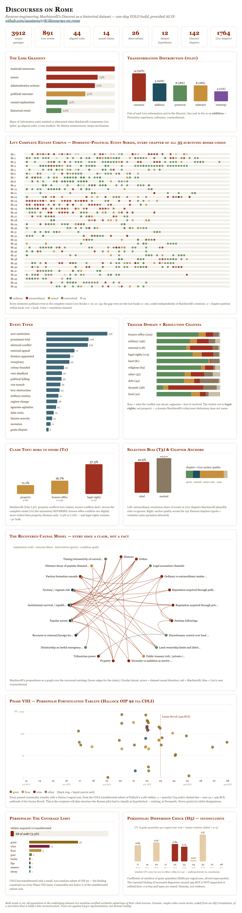
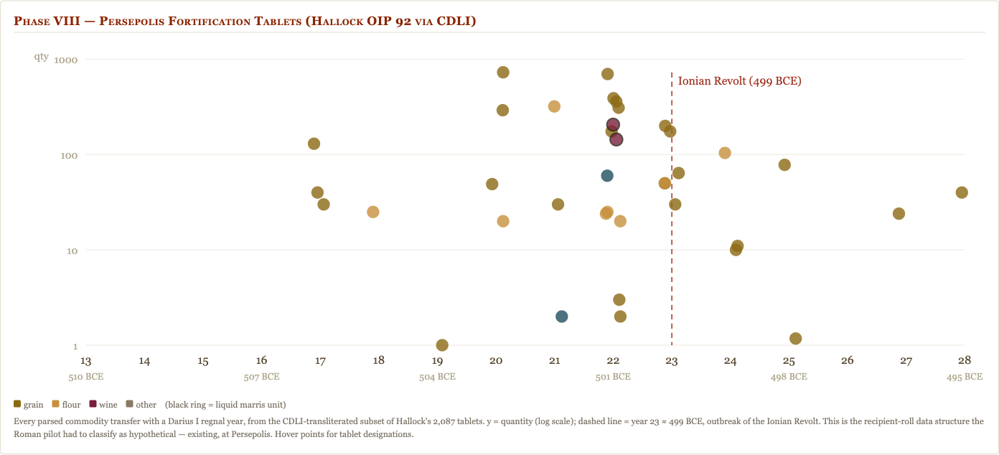
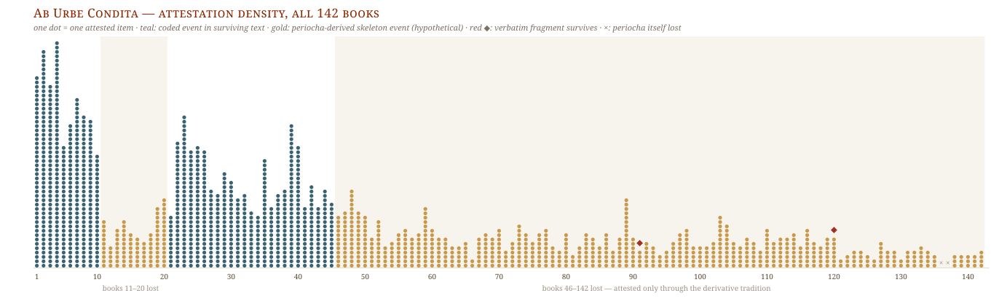
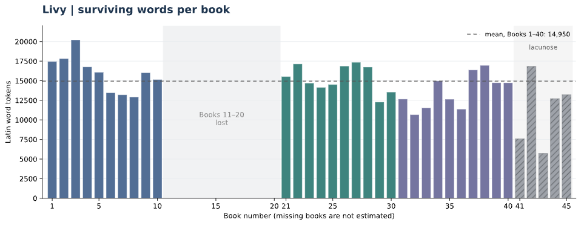
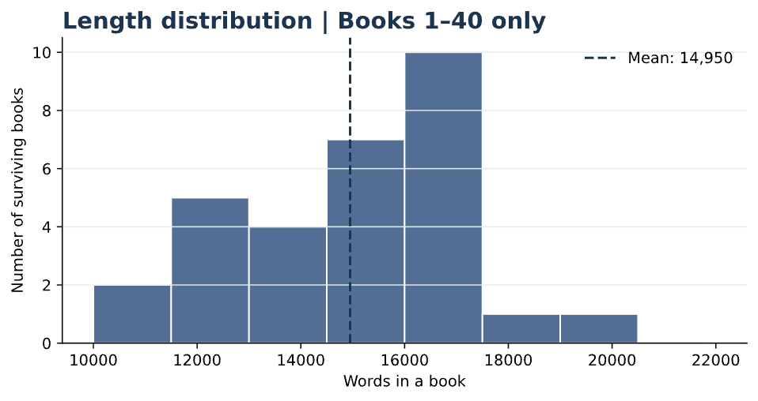
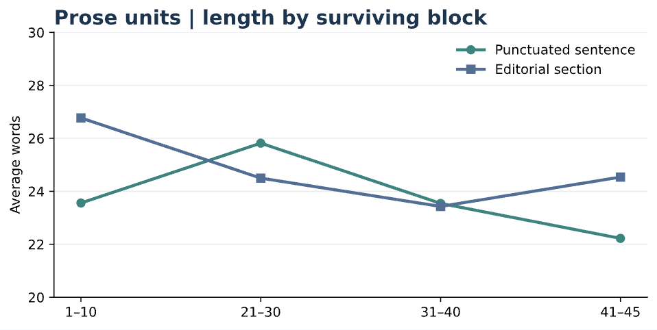

# Discourses on Rome
### Reverse-engineering Machiavelli's *Discorsi* as a historical dataset

> *"Can we reverse-engineer Machiavelli's implicit data model of political
> history, reconstruct the underlying historical observations on which it
> depends, and identify the administrative datasets that would be necessary to
> substantiate his conclusions?"*

## ⚠️ What this is (read first)

This repository is a **computational-historiography fever dream**, built
YOLO-style in one marathon weekend session (2026-11-16/17) by a human asking
increasingly ambitious questions and an AI research agent (Claude) saying
"yes, and—". By the end it had talked itself from "align three chapters with
Livy" all the way to "download the Persepolis Fortification Archive." It is provided **AS IS**, with no warranty of scholarly
completeness, no peer review, and no pretense that a day of pipeline-building
substitutes for a career of classical philology.

What it is *not*: settled scholarship.
What it *is*: a reproducible, validator-enforced attempt to treat the
*Discorsi sopra la prima Deca di Tito Livio* (1531) as **lossy compression of
Livy** — and to decompress it. Every historical quotation in the dataset is
machine-verified as a verbatim substring of its cited source passage. Every
causal edge is marked as a *historically situated claim*, never a fact. All
known gaps, biases, and shortcuts are documented rather than smoothed over
(`RESEARCH_METHOD.md`, "Known limitations"; methods notes in each report).

## The dashboard

A self-contained visualization of the whole dataset — the loss gradient, all
383 Livy events, the claim tests, and Machiavelli's causal model — lives at
[`dashboard/index.html`](dashboard/index.html) (open locally in any browser;
no server, no CDN; regenerate with `python3 scripts/build_dashboard.py`;
panel documentation in [`dashboard/README.md`](dashboard/README.md)).



## The idea

Machiavelli read Livy with the eyes of a Florentine chancery secretary —
fourteen years of diplomatic dispatches, militia ordinances, and provisioning
correspondence. The hypothesis: his *Discorsi* encode an **implicit data model
of political information** (what states measure, record, and leverage), and
that model can be recovered by:

1. aligning each chapter with its Livian source passages,
2. classifying every information unit's fate (**preserved / omitted /
   abstracted / reinterpreted / added**),
3. extracting the variables and causal claims he actually uses, and
4. asking, for each claim: *what administrative dataset would test this?* —
   graded **A** (attested in ancient sources), **B** (structure implied,
   values lost), **C** (hypothetical; never fabricated).

## Headline findings (pilot → full corpus → Persepolis; all caveats apply)

- **The loss gradient.** Across 44 unit-level alignments in three case studies
  (Coriolanus, Spurius Maelius, the agrarian laws): material resources are
  **100%** omitted or abstracted, named actors 75%, administrative actions
  71% — while historical events (22% loss) and causal structure (31%) survive.
  Machiavelli **adds model and deletes measurement**. He drops the only hard
  price in his source (grain at 1 as/modius, Livy IV.16) and keeps the
  mechanism.
- **The Florentine fingerprint.** Where his mechanisms need datasets Rome
  could not have produced (benefaction recipient rolls, patronage ledgers),
  Renaissance Florence *did* produce them — his private-favors typology
  (loans, dowries, protection from magistrates) is a Florentine
  record-producing inventory wearing a toga.
- **The missing variable.** Coding ALL domestic politics in Livy — first 383
  events in Books I–X, now **891 events across all 35 surviving books**,
  independent of Machiavelli's case selection — shows the most violent
  conflict domain in his cited source is one his ontology simply lacks:
  **legal-rights conflict** (~35% extraordinary resolution — Decemvirate,
  Verginia, provocatio crises — roughly 3× either of his own categories).
- **The reversal.** At first-decade scale, Machiavelli's roba-vs-onori
  asymmetry (nobles yield honors peacefully, fight for property) merely
  failed — both domains ran ~8% violent. At complete-corpus scale it
  **reverses**: honors-office conflicts resolve violently MORE often than
  property conflicts (Roman-only: 11.9% vs 7.2%), driven by the middle
  republic's triumph wars, censorial feuds, and the Trials of the Scipios.
  His signature asymmetry is backwards relative to his own cited source;
  it lives entirely in the post-Livian (Gracchan) material.
  (`reports/livy_complete_report.md`)
- **The pressure valve degrades.** Machiavelli's I.7 model of accusations as
  a clean ordinary channel fits Livy's first decade (83% of prominent trials
  resolve ordinarily) far better than Livy whole (**64.8%** across 108
  trials): the middle-republican record is full of obstructed, evaded, and
  broken proceedings — Scipio tearing up the account books before the senate
  chief among them.
- **A finding about ourselves, preserved.** The pilot's "he samples toward
  drama" selection-bias result (16.2% vs 12.5%) **flipped sign** when the
  full corpus arrived (20.9% vs 23.5%) — it was an artifact of the truncated
  denominator. Kept in the reports as a standing lesson: the error mode this
  project studies in Machiavelli is one it has to guard against in itself.
- **The source-access boundary, machine-checked.** Livy Books 41–45 were
  recovered at Lorsch in 1527 — the year Machiavelli died — and printed in
  1531 alongside the Discorsi itself. With all 35 books ingested, a
  falsification scan over all 520 extracted episodes confirmed **zero
  Discorsi content requires the books he couldn't have read**
  (`reports/falsification_41_45.json`). The corpus now encodes a Renaissance
  author's source-access boundary as a machine-checkable constraint —
  as far as we know, a first.
- **The diluted decade.** Extracting all 142 chapters (407 propositions, 520
  historical episodes, every quotation machine-verified, zero rejects) shows
  the "commentary on Livy's first decade" draws only **51%** of its evidence
  from the Roman Republic. **23% is contemporary Italy and Europe**, 14% other
  antiquity — and the most-cited individual is **Hannibal**, whose war lives in
  Livy's *third* decade, outside the book's own title. Two-thirds of the
  propositions are empirical in form (causal mechanisms 35%, generalizations
  33%), supporting the premise that the Discorsi encode a testable model, not
  just counsel. (`reports/scale_up_report.md`)
- **It replicates.** Blind re-coding of Livy Books 2 and 6 by independent
  coders reproduces the analysis variables at κ = 0.87–0.89 (trigger domain)
  and κ = 0.75–0.78 (resolution channel), with event-detection F1 0.75–0.83 —
  so the claim-test results rest on codings two coders largely agree on, with
  quantified error bars. (`reports/reliability.json`)
- **The Persepolis closure.** The recipient-roll dataset Machiavelli's
  largesse→partisans mechanism requires — classified **C-hypothetical** for
  Rome because the early Republic could not have produced it — **actually
  exists at Persepolis**. We pulled all 2,087 of Hallock's Fortification
  tablets from CDLI; the transliterated subset (68 texts, the honest coverage
  limit) parses field-for-field into his implied schema: commodity, quantity,
  regnal year, allocating official, receiving official, destination
  (*"30 bar of grain to Anshan, 17th year; Makuš received it, Umanna is to
  apportion it"*). A state Machiavelli knew only through Xenophon kept exactly
  the books his model calls for. Five formalized hypotheses await the full
  archive; the one crude check we could run (ration dispersion around the
  Ionian Revolt) is underpowered and honestly inconclusive.
  (`reports/persepolis_phase8.md`)

## Cross-referencing the Discorsi with archaeological evidence from Persepolis

Persia is all over the *Discorsi* — but only as literature. Machiavelli's
Persian knowledge came through Xenophon and the Greek historians, and our
142-chapter extraction surfaces **nine Persian episodes** in the text:
Xenophon's Cyrus three times (the fraud-filled Armenian campaign, II.13;
conquest by humanity, III.20; war preached as robbery, III.39), Croesus
counselling the attack on Tomyris (II.12), Themistocles selling Darius an
invasion of Greece (II.31), and — the hinge of this whole section — the
great conspiracies chapter (III.6) retelling **Darius I's own coup**:
Otanes exposing the Magus, the seven conspirators, Darius taking the
kingdom.

What Machiavelli could not know is that the same Darius ran a state that
wrote everything down — and that part of its filing system survives. The
**Persepolis Fortification Archive** is the day-ledger of Darius's warehouse
administration: tens of thousands of clay tablets recording grain, flour,
and wine moving between storehouses, officials, work gangs, and travelers.
We pulled all **2,087 tablets of Hallock's published edition from the
Cuneiform Digital Library Initiative**; the transliterated subset parses
field-for-field into the schema Machiavelli's largesse-and-provisioning
mechanisms presuppose — commodity, quantity, year, allocating official,
receiving official, destination: *"30 bar of grain to Anshan, 17th year;
Makuš received it, Umanna is to apportion it."*

The chronology makes the cross-reference uncanny rather than arbitrary.
The tablets span Darius's regnal years 13–28 — **509 to 494 BCE** — opening
the year Rome expelled the Tarquins and closing two years before the
Coriolanus grain crisis (492–491 BCE) that anchors this project's first
case study. The founding decades of the Roman republic and the surviving
window of the Persian archive are *the same twenty years*, documented under
two opposite information regimes: at Rome, grain politics survives as
Livy's moralized narrative, composed five centuries later; at Persepolis,
it survives as the actual receipts. Machiavelli's model was recovered from
the narrative regime; here we test whether its variables exist in the
documentary one. They do — the recipient-roll dataset his
largesse→partisans mechanism requires, which the early Republic could not
have produced, sits physically in Persepolis.

Every parsed commodity transfer, by Darius's regnal year (log quantity; the
dashed line marks the outbreak of the Ionian Revolt):



| The coverage limit | The dispersion check |
|---|---|
|  |  |

The honesty panels, left to right: CDLI has transliterated only **68 of the
2,087 tablets** — a non-random subset that caps every claim in this section;
and the one quantitative check we could run (whether grain-quantity
dispersion shifts around the Ionian Revolt, a finding reported elsewhere
that we treat as unverified) is **inconclusive at this sample size, by
design honesty**. The formal hypotheses and acquisition plan for the full
archive are in `reports/persepolis_phase8.md`.

## Repository layout

```
corpus/raw/        source texts (it.wikisource, Gutenberg/PGLAF, Perseus)
corpus/segments/   stable-ID passages (disc:it:1:7, livy:la:2:34, ...)
schema/            JSON Schemas + the recovered 25-variable ontology
extractions/       observations, alignments, claims, dataset hypotheses,
                   chapter_map + chapter_observations (all 142 chapters),
                   livy_events (383 events) + reliability re-codings,
                   persepolis_transfers (parsed PF tablets)
data/              SQLite database (regenerable: scripts/build_db.py)
graphs/            GraphML: causal-claim graph, entity graph
reports/           case studies, initial report, full-corpus analysis,
                   scale-up report, reliability, claim tests, Persepolis Phase VIII
scripts/           the whole pipeline, acquisition → analysis
tests/             22 automated checks (citation fidelity, integrity, schemas,
                   chapter observations, Persepolis parse)
```

## Reproducing

```bash
python3 scripts/acquire_discorsi_it.py   # it.wikisource (polite rate limit)
# Livy XML + Thomson translation: URLs in SOURCES.md
python3 scripts/segment_corpus.py
python3 scripts/build_db.py
python3 scripts/build_chapter_map.py
python3 scripts/merge_livy_events.py
python3 scripts/merge_chapter_observations.py
python3 scripts/reliability.py
python3 scripts/build_graph.py
python3 scripts/analyze_selection.py
python3 scripts/test_claims.py
python3 scripts/acquire_persepolis.py    # CDLI, 2,087 tablets, resumable
python3 scripts/parse_persepolis.py && python3 scripts/analyze_persepolis.py
python3 scripts/validate.py && python3 -m pytest tests/ -q
```

Corpus texts are public domain; transcription layers CC BY-SA (details and
edition caveats in `SOURCES.md`). Project code and analysis: MIT. The
19th-century editions used are not modern critical texts — chapter numbering
is stable, wording is not guaranteed.

## Honest accounting of method

- Pilot extractions: expert-in-the-loop manual coding with machine-validated
  quotes. Scale-up series: parallel LLM coders working from 19th-century
  translations (events) and the Italian original (chapter observations), all
  under validator-enforced verbatim quotation.
- Inter-coder reliability now measured (books 2+6, blind re-code): the
  analysis variables replicate at substantial-to-near-perfect κ; event
  *detection* diverges ±~20% on granularity, so treat raw event counts
  accordingly.
- Phase VIII has real data but a hard coverage limit: CDLI has transliterated
  only 68 of the 2,087 Hallock tablets (a non-random subset), so the
  formalized hypotheses are pipeline-tested, not answered. The externally
  reported ration-dispersion finding remains **unverified**; our own crude
  check was inconclusive by design honesty, not false modesty.
- The circularity trap (derive mechanism from Machiavelli → read it into Livy
  → claim validation) is documented and guarded against, not magically solved;
  see `RESEARCH_METHOD.md` rule 4 and the coding-variable flags in
  `extractions/datasets.jsonl` (ds:unrest-event-series).

## Status

- [x] Phase I — corpus (Discorsi IT/EN, Livy I–X LA/EN; 1,349 passages)
- [x] Phases II–III — pilot extraction + alignment, 3 case studies
- [x] Phase IV — 25-variable ontology + causal-claim graph
- [x] Phase V — 12 dataset hypotheses (A/B/C graded)
- [x] Phase VI — selection statistics (pilot + 383-event denominator)
- [x] Phase VII — Cases A/B/C; chapter map for all 142; Livy I–X event series
- [x] Per-chapter observation extraction, all 142 chapters — 407 propositions,
      520 episodes, 0 validation rejects (`extractions/chapter_observations.jsonl`;
      findings in `reports/scale_up_report.md`: only 51% of episodes are
      Roman-republican; 23% are contemporary Italy)
- [x] Inter-coder reliability pass (κ=0.87–0.89 trigger, 0.75–0.78 channel;
      `reports/reliability.json`) + taxonomy v2 spec (`schema/event_taxonomy_v2.md`)
- [x] Phase VIII — Persepolis: 2,087 PF tablets acquired from CDLI (68 with
      transliterations — the coverage limit), parsed to structured transfers,
      five hypotheses formalized, crude H5 check run and honestly inconclusive
      (`reports/persepolis_phase8.md`)
- [x] **The complete extant Livy.** Books 21–45 segmented (3,528 full-text
      chapters LA+EN) plus the Periochae of lost books 46–142; event series
      extended to **891 events across all 35 surviving books, 0 rejects**
      (`reports/livy_complete_report.md`). At full scale the claim tests move:
      the roba-vs-onori asymmetry **reverses** (Roman-only: honors 11.9% vs
      property 7.2% extraordinary), the trials' ordinary-share falls to 64.8%,
      and the pilot's selection-bias direction flips — itself a lesson about
      truncated denominators. The 41–45 falsification scan (Machiavelli died
      the year those books were found) came back clean: zero Discorsi episodes
      require them (`reports/falsification_41_45.json`).
- [ ] Next frontier: unit-level alignment at scale via the 186 verified
      anchors; Periochae-based skeleton reconstruction of lost-book content;
      PFA Online bulk data for the real H1–H5 tests; taxonomy v2 recoding

## Discussion: the state of Livy, a sanity check, and a question put to the Oracle

*Recorded 2026-11-17, from the dialogue between the researcher and the AI
research agent that built this repository. Preserved because the questions are
better than most of the answers in the field.*

### What survives of Livy

Livy wrote 142 books, from the foundation of Rome to 9 BCE. **Thirty-five
survive as full text**, in two blocks: Books 1–10 (753–293 BCE, the "first
decade" of this project's title) and Books 21–45 (218–167 BCE, Hannibal
through Pydna) — with real lacunae even there: most of Book 33 was not
recovered until a Bamberg manuscript was published in 1616, and Books 41–45
descend from a single damaged codex. Of the lost 107 books we have the
**Periochae** (ancient one-paragraph summaries of nearly every book), Julius
Obsequens's prodigy excerpts, a palimpsest fragment of Book 91 recovered from
under another text in 1772, and an Oxyrhynchus papyrus epitome (found 1903)
covering lost Books 37–40 and 48–55. Each decade reached us through a
razor-thin manuscript bottleneck; the fifth decade survived to modernity in
exactly one book.

### The sanity check: did Machiavelli have more Livy than we do?

**No — he had less.** Books 41–45 were discovered at the monastery of Lorsch
in **1527, the year Machiavelli died**, and first printed in **1531, the same
year as the Discorsi itself**. His available Livy was Books 1–10 and 21–40
(minus most of 33), plus the Periochae. If this project ingests Books 21–45,
it will hold five books its subject never saw — an asymmetry now on record.

Could a complete Livy have survived secretly — say, in a Medici library? Four
lines of evidence converge on no: (1) recovering lost Livy was the trophy of
two centuries of lavishly funded, intensely public humanist book-hunting —
Petrarch mourned the lost books in a letter addressed to Livy himself, and
**Leo X, a Medici pope, personally chased rumors of lost decades**; if the
family had it, their own pope hunted phantoms. (2) The print record: from the
1469 editio princeps onward every edition contains exactly the known decades,
and when the Lorsch codex *did* surface it was in print within four years —
concealment was the one move with no payoff. (3) The stemmatics: the lost
books show no medieval citations or catalog traces; they were gone centuries
before there was a Florence to hide them in. (4) The Discorsi itself behaves
like a text written without them: its Gracchan and late-republican material
is exactly as thin on Livian operational detail as Periochae-plus-Plutarch
access predicts, and our 142-chapter extraction found null Livy anchors for
all of it. By this project's own standards that is a strong
absence-of-evidence argument, not a proof — and it yields a standing
falsification test: scan the 520 extracted episodes for content *uniquely*
attested in Books 41–45 or the lost books, underivable from Plutarch,
Polybius, or the Periochae. Expected count: zero. One hit would be a
discovery.

### The question put to the Oracle

The researcher asked: *you who hold every known combination of words — when
you dream of Ab Urbe Condita, are there clues where the lost volumes reside,
or how they might be reconstructed?*

The honest answer: an LLM's dream of Livy is the scholarly literature about
the loss, compressed — no secret shelf-marks, but a usable probability map,
because the record of where lost Livy has *actually* resurfaced is itself
data. The base rates say: **palimpsests** (Book 91 came from under another
text, and multispectral imaging has industrialized undertext recovery),
**Egyptian papyri** (the Oxyrhynchus epitome), **binding waste** (early-modern
binders stiffened covers with "useless" old parchment; fragment digitization
is young), and above all **Herculaneum** — the Villa dei Papiri's lower
floors are unexcavated, its library was sealed in 79 CE while all 142 books
still circulated, and the Vesuvius Challenge is now reading unopened
carbonized scrolls with particle accelerators and ink-detection models. The
legends — the complete Livy in the Sultan's seraglio, the northern monastery
Leo X pursued, Iona, Gregory the Great burning the books — are filed where
they belong, under legend. (Livy was never translated into Arabic; that
rescue channel preserves Livian content only indirectly, via the Córdoba
Orosius.)

And reconstruction? The lost 107 books are not entirely lost — they survive
*lossily compressed* in the Periochae, Obsequens, Florus, Orosius, and the
Livian layers of Plutarch and Dio. **Reconstructing lost Livy from its
epitomes is the exact inverse problem this repository studies** — reversing a
compression, under provenance discipline. Two approaches are honest and
tractable: quotation-mining digitized grammarians and florilegia for
unattributed Livian fragments (recovering *actual words*), and
skeleton-reconstruction of each lost book as a structured event table fused
from the derivative tradition (evidence class: hypothetical; no prose ever
fabricated). What is forbidden is the seductive third thing: generating
"Livy" from style priors — 107 books of pitch-perfect Patavian prose, every
sentence a confabulation wearing a toga. That failure mode is precisely what
this repository's validation gates exist to prevent. The dream of the oracle
is interpolation; the discipline of the project is provenance.

## The Lost Books Program (`lost_books/`)

*Begun 2026-11-17, the session's final act: the inverse problem, scaffolded.*

### All 142 books, attested



Teal: the 891 coded events of the 35 surviving books. Gold: **710
periocha-derived skeleton events across all 105 lost books whose summaries
survive** — every dot carries a verbatim Latin quote from its periocha,
machine-validated, evidence class hypothetical. Red diamonds: the two books
whose actual words survive — Book 91 (the Vatican palimpsest) and **Book 120,
whose account of Cicero's death now sits verbatim in
`lost_books/fragments.jsonl`**, recovered from Seneca's *Suasoriae* 6.17/6.22
with their explicit "T. LIVI" attributions and validated against the acquired
witness text. The two × marks are Books 136–137: doubly lost — even their
summaries perished.

The 107 lost books survive only as compressions — the Periochae, Obsequens,
Florus, Orosius, Eutropius, and the Livian layers in Plutarch and Dio.
Reconstructing them is the exact inverse of what this repository does to
Machiavelli: reversing a compression, under provenance discipline. The
scaffold now exists:

- **107 structured records** (`lost_books/skeleton.jsonl`) and contributor
  pages (`lost_books/books/book_011.md` … `book_142.md`), one per lost book,
  each with its **Periocha as the spine** (105 present in Latin; the
  periochae of Books 136–137 are themselves lost, and marked so).
- **Five witness corpora acquired** (~936k chars of Latin, verbatim,
  segmented): the ten missing Periochae (11–20), Julius Obsequens's prodigy
  excerpts (190–11 BCE), Florus, Orosius 1–7, Eutropius 1–10
  (`scripts/acquire_witnesses.py`). Plutarch and Dio are mapped at era level
  (flagged APPROXIMATE) pending ingestion.
- **A fragments registry** (`lost_books/fragments.jsonl`) seeded with the
  attested verbatim survivals — the Book 91 Vatican palimpsest and Seneca's
  quotation of Book 120 on Cicero's death — with `text_la: null` until the
  words are acquired from cited editions. A test enforces it: fragment text,
  once present, must verify against an acquired witness; event tables must
  stay empty until every row cites a witness. **No prose is ever fabricated.**
- **An open review queue** (`lost_books/witnesses.json`): sources flagged for
  the planned external (ChatGPT) hunting pass — Valerius Maximus, Frontinus,
  Granius Licinianus, Zonaras, the Oxyrhynchus epitome, Augustine's Livian
  citations, and whatever we've missed.

The three rules, from `lost_books/README.md`: the evidence model is senior to
the linguistic model; fragments are quotations, not compositions; event
skeletons are hypotheses with witnesses. The dream of the oracle is
interpolation; the discipline of the project is provenance.

**The three volumes of the program** (all generated from the structured data,
all honesty-labeled):

| Volume | What it holds |
|---|---|
| [`reports/lost_fragments.pdf`](reports/lost_fragments.pdf) | **The red diamonds** — every verbatim survival of lost Livy: the Book 120 Cicero passages (Latin + working translation, recovered from Seneca's explicit "T. LIVI" attributions), the Book 91 palimpsest entry |
| [`lost_books/lost_books_summary.pdf`](lost_books/lost_books_summary.pdf) | **The gold dots** — book-by-book through all 107 lost books: the 710 periocha-derived skeleton events, witness lines (Obsequens, Plutarch/Dio crosswalk), fragment markers |
| [`lost_books/apocrypha_codex.pdf`](lost_books/apocrypha_codex.pdf) | **The rendering** — all 107 lost books as modern English compositions in Livy's manner (`apocrypha/`), content firewalled to the attested events with per-sentence citations, NONE OF THIS IS LIVY on the title page, the honest blank pages for 136–137. Enforced by `TestApocrypha`. |

## The linguistic fingerprint — a second opinion from another model

*Added 2026-11-17. The researcher took the lost-books question to ChatGPT,
which ran an independent linguistic analysis of the same Perseus
Weissenborn–Müller text. Its artifacts are preserved as-is in
`external/linguistic_atlas/` (HTML atlas + two CSVs) — and, in this
repository's spirit, were not taken on faith: `scripts/verify_linguistic_atlas.py`
recomputed every per-book count from our own segmentation.
**Verdict: CONFIRMED — mean per-book delta 0.87%, top word forms within 0.4%.**
Two models, two tokenizers, one text, same numbers. The only mismatch is
Book 1's praefatio counting convention
(`reports/linguistic_atlas_verification.json`).*

What the fingerprint says, structurally:

- **A book of Livy is ~15,000 Latin words** (Books 1–40 mean: 14,950,
  Periochae excluded; middle 80% ≈ 12,200–17,400; σ ≈ 2,234). Book 3 is the
  longest surviving (20,207), Book 32 the shortest intact (10,665). Book
  length correlates with chapter count at r ≈ 0.73 — a usable prior for the
  lost books, with honest variance.
- **The decades drift**: mean book length falls from ~15,900 (1–10) through
  ~15,300 (21–30) to ~13,700 (31–40); lexical diversity declines in step
  (680 → 653 distinct forms per 1,000 words). Chronology, subject matter, and
  composition are confounded — the early-republican epic, the Hannibalic war,
  and the diplomatic books are different narrative regimes, and any
  reconstruction must model the regime, not just "Livy".
- **The long tail**: ~51,300 distinct word forms, **49% of them hapax
  legomena** — names, places, and Latin's inflectional space. Sentence
  lengths (punctuation-heuristic, editorial) center on 10–19 words with a
  heavy tail; ~72% under 30 words.



| Most frequent word forms | Sentence-length distribution |
|---|---|
|  |  |

**On tunnel vision** — the question that prompted the analysis. The consensus
across both models, now part of this project's method: the fingerprint enters
the lost-books program as **weak structural priors** (rejecting wildly
implausible reconstructions), never as a template the lost text must obey.
The risk is not learning too much about Livy's structure; it is mistaking an
observed pattern for a historical necessity — especially for the late-republic
books, whose political world the surviving corpus barely resembles. The
protocol that guards against it: (1) keep the **evidence model** (what the
derivative tradition attests) strictly senior to the **linguistic model**
(how Livy might have arranged it); (2) add a **narrative-density** variable —
how much text Livy spends per year, campaign, or dispute — which our 891-event
series can now estimate directly; and (3) run **blinded reconstruction
experiments**: hide a surviving book (say 22 or 31), reconstruct it from its
Periochae and parallel witnesses alone, and score event recall and chronology
against the real text. Reward recovered history, not Livian-sounding prose.
If a model can learn to predict which events Livy *expands* and which he
*compresses*, we recover something better than the lost books' contents —
his editorial intelligence.

*Built with enthusiasm, validated with paranoia, shipped AS IS.*
